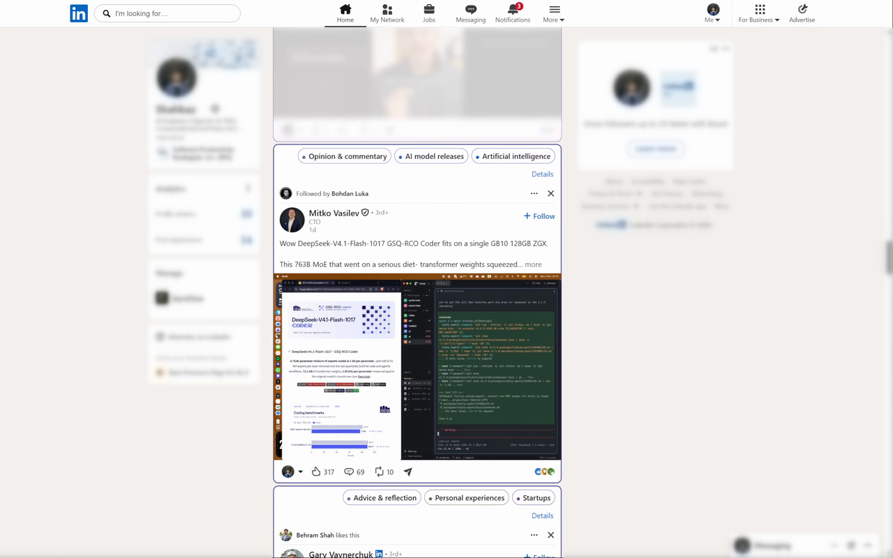
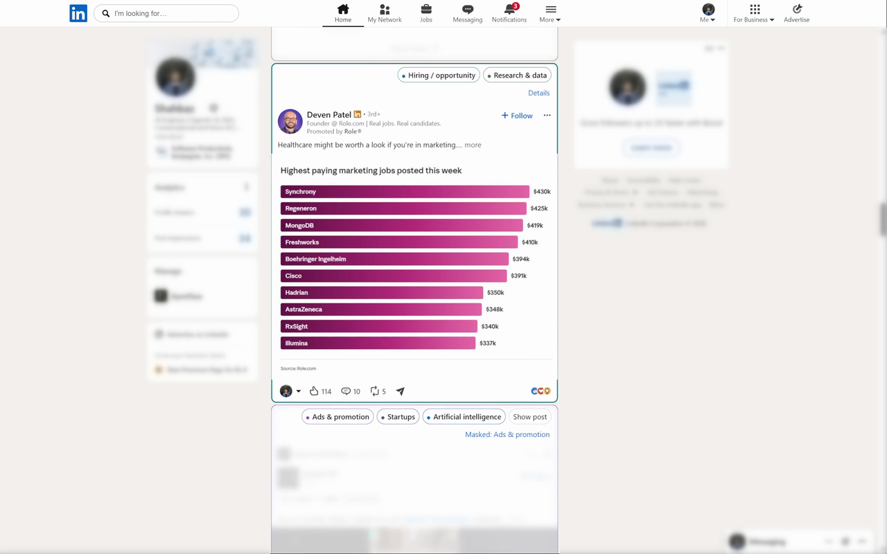
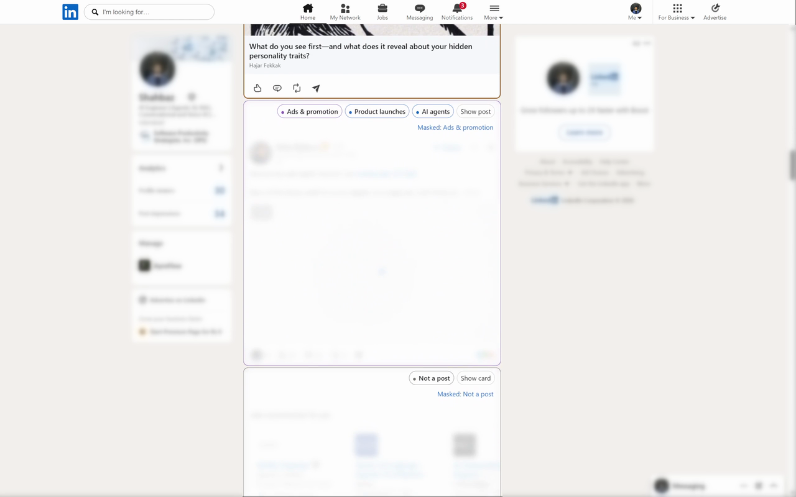
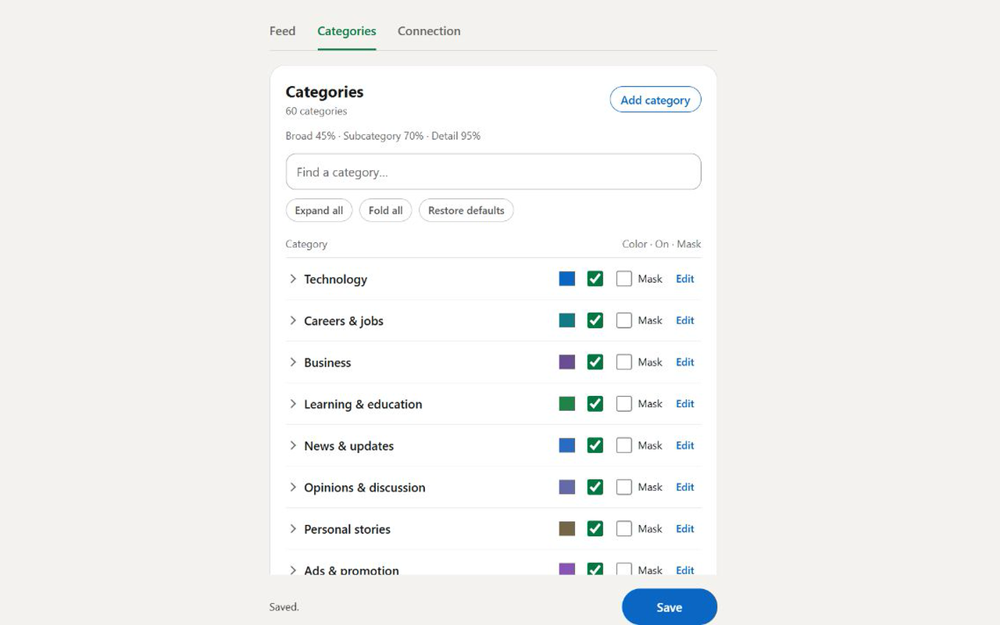

<p align="center">
  
</p>

<h1 align="center">LinkedIn Lens</h1>
<p align="center"><strong>Your feed. Your filters.</strong></p>
<p align="center">AI categories, reversible masks, and more control over what gets your attention on LinkedIn.</p>

<p align="center">
  <a href="https://github.com/Pakzone1/LinkedIn-Lens/actions/workflows/release.yml"></a>
  
  
</p>

<p align="center">
  <a href="https://github.com/Pakzone1/LinkedIn-Lens/releases/latest"><strong>Download the extension</strong></a>
  · <a href="#see-it-in-action">See it in action</a>
  · <a href="docs/USAGE.md">User guide</a>
</p>

---

You open LinkedIn to see what is happening in your field. LinkedIn Lens helps you keep the feed focused on what you came for.

It understands posts through an AI decision model, adds useful category labels, and masks the categories you choose. Every mask tells you why it is there. Anything can be revealed with one click.

**60 editable categories · 3 levels of detail · 10-post lookahead · 0 runtime dependencies**



## A surprisingly capable little extension

| Feature | What you get |
| --- | --- |
| **AI categorization** | Topics such as AI, careers, research, industry news, launches and promotions, organized into a three-level tree. |
| **Your own rules** | Edit names, descriptions and colors. Add categories and subcategories. Choose exactly which branches to mask. |
| **Clear, reversible masks** | See the active mask reason, reveal a post, or correct a category yourself. Posts keep their place in the feed. |
| **Ad and promotion controls** | Recognizable advertising labels and separate handling for paid sponsorships and organic promotion. |
| **A feed that keeps moving** | Visible posts and the next 10 loaded posts are analyzed as you scroll, with cached results reused. |
| **Cleaner card handling** | Job recommendations and offer modules have their own Not a post result and mask setting. |
| **Optional comment drafts** | Choose a tone or give your own direction, generate a draft, edit it, and Copy or Insert it. |
| **Feed, profiles and posts** | The same controls follow you across LinkedIn's home feed, profile activity and individual posts. |

## See it in action

These screenshots come from the extension running on my actual LinkedIn feed. Side profiles and sidebar details are blurred in the demo.

### Keep the posts you came for

Topic badges make it easy to see what a post is about. Here, career-related content stays visible while promotions below it are masked.



### Give the noise its own rules

Promotions and non-post cards can be masked independently. The reason stays visible, together with a one-click reveal control.



### Make the categories yours

Start with the included category tree, then shape it around your interests. Search, expand, edit, recolor, enable and mask from one settings panel.



## Install from GitHub

1. Download **LinkedIn-Lens-1.0.0-chrome.zip** from the [latest release](https://github.com/Pakzone1/LinkedIn-Lens/releases/latest) and extract it.
2. Open `chrome://extensions` or `edge://extensions`, enable **Developer mode**, and choose **Load unpacked**. Select the extracted folder containing `manifest.json`.
3. Open Lens settings, review and accept cloud AI processing, then enter your [OpenRouter API key](https://openrouter.ai/settings/keys) under **Connection**. Connect an account with available provider credits, enable Lens and Save.
4. Refresh LinkedIn and choose your filters. Enable **Suggest comments** if you want the drafting tools too.

Your API key, preferences and category definitions are managed in extension settings. Read the [privacy policy](PRIVACY.md) for how cloud processing and storage work.

## Built to stay lean

Plain JavaScript, CSS and Manifest V3. No runtime dependencies or bundler. The extension combines a typed AI classification pipeline, a customizable category tree, reversible feed controls and a small background worker.

Classification uses **Perplexity Decider V1.2** through OpenRouter. Optional comment drafts use a separately configurable generative model. [Architecture details →](docs/ARCHITECTURE.md)

### Develop

Requirements: Node.js 24+ and Python 3.9+.

```sh
npm test
npm run check
python tests/package_test.py
npm run package
```

Load `extension/` directly while developing. The packager creates a runtime-only Chrome ZIP and SHA-256 checksum in `dist/`.

**37 Node tests and 146 browser-fixture assertions** cover classification, masks, settings, consent, request handling and interaction behavior. GitHub Actions validates changes and publishes version-tagged release packages.

### Publish

The [Chrome Web Store submission guide](store/SUBMISSION.md) includes the upload process, listing copy, privacy fields, reviewer instructions and five listing screenshots. The [release page](https://github.com/Pakzone1/LinkedIn-Lens/releases/latest) provides the upload ZIP.

## Built by Shahbaz

A small project built around a simple idea: your LinkedIn feed should be useful for what you actually opened it to do.

[GitHub](https://github.com/Pakzone1) · [LinkedIn](https://www.linkedin.com/in/shahbaz-shz32190/) · [Website](https://ayroflow.com) · [Report an issue](https://github.com/Pakzone1/LinkedIn-Lens/issues)
